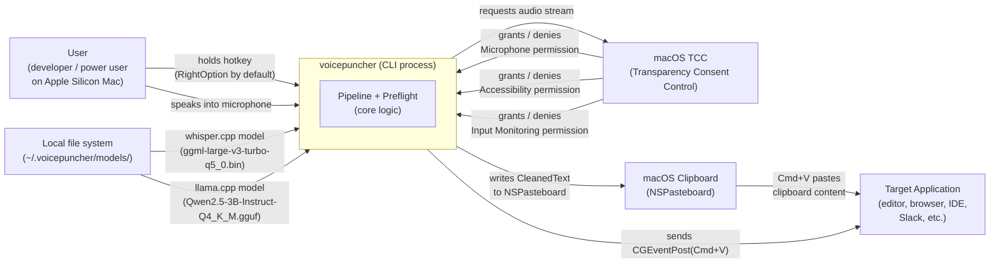
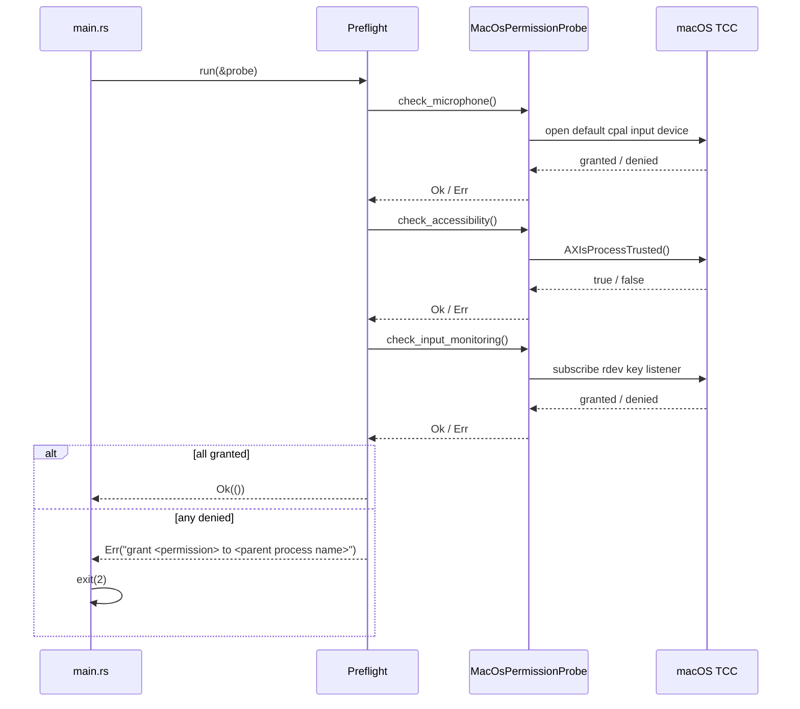

# Context and Scope

## System Context

voicepuncher is a single OS process with no server side. It reads audio from CoreAudio, runs inference fully in-process on Apple Silicon Metal, and delivers the result by writing to the system clipboard and synthesizing a Cmd+V keystroke. The three macOS TCC permissions must be granted to the terminal emulator that launches the process — the process inherits them from its parent.

## External Systems

| External system | Direction | What is exchanged |
|---|---|---|
| macOS TCC (Transparency Consent Control) | voicepuncher → macOS | Permission probe at startup (`AXIsProcessTrusted`, `cpal` device open, `rdev` key-event subscription); returns grant or denial per permission |
| CoreAudio (via `cpal`) | macOS → voicepuncher | Raw PCM audio frames from the default input device; streamed during the `Recording` state |
| `rdev` global key listener | macOS → voicepuncher | Raw keyboard events delivered as `PttSignal::Pressed` / `PttSignal::Released` when the configured hotkey changes state |
| Local model files (`~/.voicepuncher/models/`) | file system → voicepuncher | Whisper GGML binary and Qwen2.5 GGUF binary, loaded once at startup and kept resident in RAM |
| NSPasteboard (macOS clipboard) | voicepuncher → macOS | `CleanedText` written as a plain-text clipboard entry via `arboard` |
| CGEventPost (macOS event injection) | voicepuncher → macOS | Synthetic Cmd+V key-down/key-up pair injected into the global event stream to trigger paste in the frontmost application |
| Target application (editor, browser, etc.) | macOS → target app | Receives the synthetic Cmd+V and reads the clipboard; voicepuncher has no direct channel to the target application |

## Permission Flow at Startup

`Preflight` is the only place in the codebase that interacts with macOS TCC. It runs before any adapter is constructed, so a missing permission produces a single human-readable error message that names the parent process (e.g. `iTerm2`) rather than a cryptic OS error.
