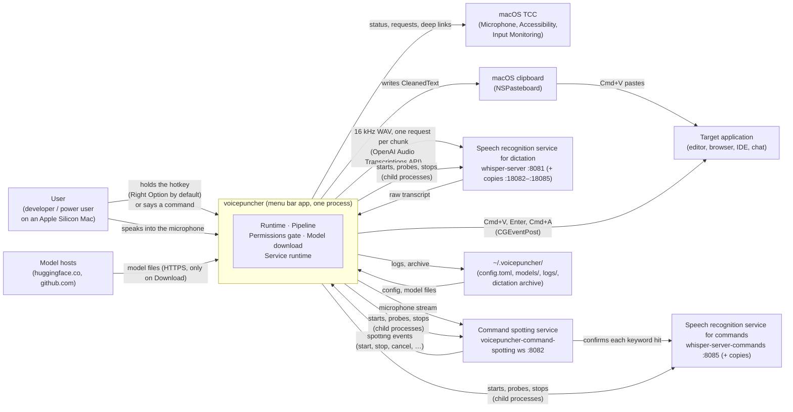

# Context and Scope

## System Context

voicepuncher is a single OS process with no server side of its own: a menu bar application the user drives through the hotkey, voice commands, its menu and its windows (Permissions, Download, Settings); the terminal is for developers and file mode. It reads audio from CoreAudio, sends it to the local services on the same machine (loopback only; any other host is refused by the configuration loader), and delivers the result by writing to the system clipboard and synthesizing a Cmd+V keystroke. No model is loaded into the app's memory: speech recognition and command confirmation each run in a service process of their own on Metal, which the app starts and supervises in hotkey mode (`[services] manage`, on by default) or which `just start-model-servers` starts for development. The three macOS TCC permissions are granted to the app bundle, or, when the bare binary runs from a terminal, to that terminal — macOS attributes them to the responsible parent application; the Permissions window names which one.

## External Systems

| External system | Direction | What is exchanged |
|---|---|---|
| macOS TCC (Transparency Consent Control) | voicepuncher → macOS | Permission status at launch and every 2 s (waiting) or 5 s (Ready): AVFoundation authorization status, `AXIsProcessTrustedWithOptions`, `IOHIDCheckAccess`; returns granted, not granted or not asked yet per permission, without opening a device. Requests: `requestAccessForMediaType`, the AX prompt option, `IOHIDRequestAccess` |
| CoreAudio (via `cpal`) | macOS → voicepuncher | Raw PCM audio frames from the default input device, resampled to 16 kHz mono; streamed during the `Recording` state and, while voice control listens, to the command spotting service |
| `CGEventTap` global key listener | macOS → voicepuncher | Raw keyboard events delivered as `PttSignal::Pressed` / `PttSignal::Released` when the configured hotkey changes state |
| Speech recognition service for dictation (`whisper-server`, large-v3-turbo q5_0, port 8081) | voicepuncher ↔ service, loopback HTTP | One `POST /v1/audio/transcriptions` per recording or chunk (16 kHz mono WAV); returns the raw transcript. The service runs as copies on the ports 10000 above its own; the copy pool leases a free copy per request |
| Command spotting service (`voicepuncher-command-spotting`, port 8082) | voicepuncher ↔ service, loopback WebSocket | The microphone stream while listening; back come spotting events (a command, its placement, the speech heard around it), health and protocol version; the app reconnects when the service is away |
| Speech recognition service for commands (`whisper-server-commands`, small, port 8085) | command spotting service → service, loopback HTTP | The clip around each keyword hit, transcribed to confirm or reject the command; the app never calls it |
| Local service processes | voicepuncher → macOS | With `[services] manage` on: started as child processes in their own process group, output in `~/.voicepuncher/logs/<binary>-<port>.log`, probed over loopback HTTP on a 100 ms tick, restarted when they die, asked to end (SIGTERM, then SIGKILL after 5 s) when the app quits; a service that already answers is adopted and left running |
| Model hosts (`huggingface.co`, `github.com` and their CDNs) | voicepuncher → internet, HTTPS | Only when the user clicks Download (or runs `--download-models`): one GET per missing model file at its pinned address, with `Range` to resume a part; `VOICEPUNCHER_MODEL_MIRROR` replaces the hosts |
| Local model files (`~/.voicepuncher/models/`) | file system → services | The Whisper, VAD, keyword spotting files, loaded by the services the app starts; the app only checks their presence and checksums |
| Dictation archive (`~/.voicepuncher/history/` by default) | voicepuncher → file system | With archiving on: each dictation as a folder with `audio.wav` and `entry.json` (the transcript, timings) |
| `afplay` | voicepuncher → macOS | One child process per start or stop cue |
| NSPasteboard (macOS clipboard) | voicepuncher → macOS | `CleanedText` written as a plain-text clipboard entry via `arboard` |
| CGEventPost (macOS event injection) | voicepuncher → macOS | Synthetic Cmd+V key-down/key-up pair injected into the global event stream to paste in the frontmost application; Enter and Cmd+A for the voice commands |
| Accessibility API (`AXUIElement`) | voicepuncher → macOS | Whether a text input has the focus, before a command that types |
| Target application (editor, browser, etc.) | macOS → target app | Receives the synthetic keystrokes and reads the clipboard; voicepuncher has no direct channel to the target application |

## Permission Flow

`PermissionsGate` is the only use case that asks macOS TCC for permissions. The runtime's thread is the only poller: it starts the pipeline once every permission is granted and stops it when one is revoked, without a relaunch; the Permissions window opens on the state Waiting for permissions and names the responsible application when the bare binary runs from a terminal. File mode never asks the gate.
