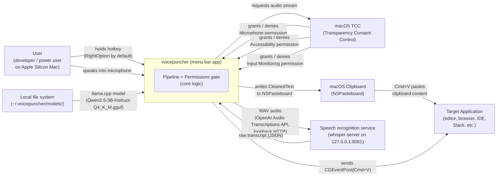
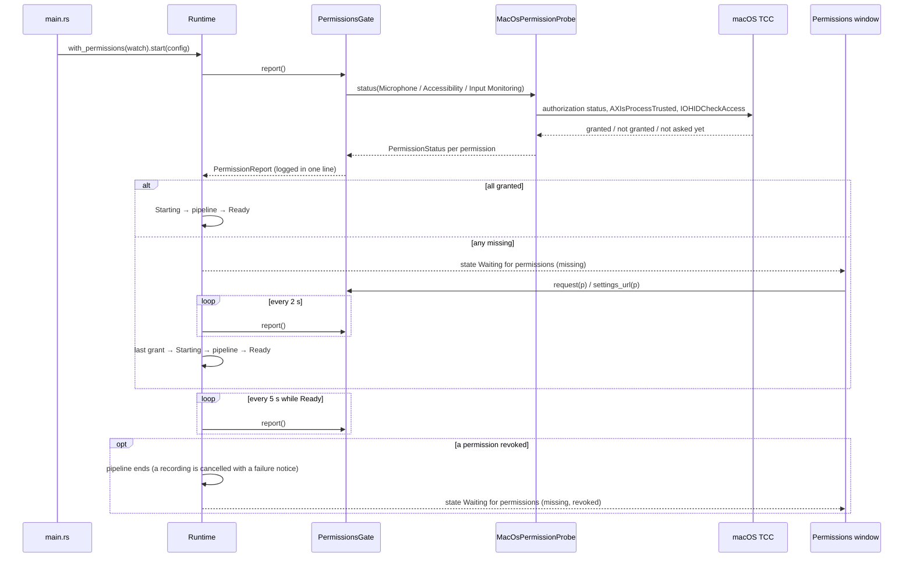

# Context and Scope

## System Context

voicepuncher is a single OS process with no server side of its own: a menu bar application the user drives through its menu and windows (Permissions, Download, Settings); the terminal is only for developers and file mode. It reads audio from CoreAudio, sends it to a speech recognition service on the same machine (loopback only), runs text refinement in-process on Apple Silicon Metal, and delivers the result by writing to the system clipboard and synthesizing a Cmd+V keystroke. The three macOS TCC permissions are granted to the app bundle, or, when the bare binary runs from a terminal, to that terminal — macOS attributes them to the responsible parent application; the Permissions window names which one.

## External Systems

| External system | Direction | What is exchanged |
|---|---|---|
| macOS TCC (Transparency Consent Control) | voicepuncher → macOS | Permission status at launch and every 2 s (waiting) or 5 s (Ready): AVFoundation authorization status, `AXIsProcessTrustedWithOptions`, `IOHIDCheckAccess`; returns granted, not granted or not asked yet per permission, without opening a device. Requests: `requestAccessForMediaType`, the AX prompt option, `IOHIDRequestAccess` |
| CoreAudio (via `cpal`) | macOS → voicepuncher | Raw PCM audio frames from the default input device; streamed during the `Recording` state |
| `rdev` global key listener | macOS → voicepuncher | Raw keyboard events delivered as `PttSignal::Pressed` / `PttSignal::Released` when the configured hotkey changes state |
| Speech recognition service (`whisper-server`, started by the app in hotkey mode or with `just start-model-servers`) | voicepuncher ↔ service over loopback HTTP | One `POST /v1/audio/transcriptions` per recording or live chunk (16 kHz mono WAV); returns the raw transcript. Checked for reachability at startup |
| Local service processes (`whisper-server`, `llama-server`, `voicepuncher-command-spotting`) | voicepuncher → macOS | With `[services] manage` on: started as child processes, their output in `~/.voicepuncher/logs/<binary>-<port>.log`, checked over loopback HTTP, asked to end (SIGTERM, then SIGKILL after 5 s) when the app quits |
| Model hosts (`huggingface.co`, `github.com` and their CDNs) | voicepuncher → internet, HTTPS | Only when the user clicks Download (or runs `--download-models`): one GET per missing model file at its pinned address, with `Range` to resume a part; `VOICEPUNCHER_MODEL_MIRROR` replaces the hosts |
| Local model files (`~/.voicepuncher/models/`) | file system → voicepuncher | Qwen2.5 GGUF binary, loaded once at startup and kept resident in RAM (the Whisper model is loaded by the speech recognition service) |
| NSPasteboard (macOS clipboard) | voicepuncher → macOS | `CleanedText` written as a plain-text clipboard entry via `arboard` |
| CGEventPost (macOS event injection) | voicepuncher → macOS | Synthetic Cmd+V key-down/key-up pair injected into the global event stream to trigger paste in the frontmost application |
| Target application (editor, browser, etc.) | macOS → target app | Receives the synthetic Cmd+V and reads the clipboard; voicepuncher has no direct channel to the target application |

## Permission Flow

`PermissionsGate` is the only use case that asks macOS TCC for permissions. The runtime's thread is the only poller: it starts the pipeline once every permission is granted and stops it when one is revoked, without a relaunch; the Permissions window opens on the state Waiting for permissions and names the responsible application when the bare binary runs from a terminal. File mode never asks the gate.
