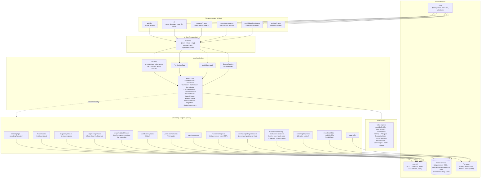

# System Overview

voicepuncher is an offline push-to-talk voice-to-text menu bar application for macOS Apple Silicon; its command line remains for developers and file mode. The user holds a configurable hotkey (or says a voice command), speaks, releases — the speech is transcribed by a local speech recognition service and pasted at the cursor. Nothing leaves the machine: the app opens loopback connections only, and every service runs on the Apple Silicon GPU through Metal.

The repository is a Cargo workspace of four crates (`docs/project-map.md` lists their modules):

| Crate | Role |
|---|---|
| `app/` | The application: hexagonal architecture, one process, the menu bar item and its windows |
| `command-spotting/` | The command spotting service: sherpa-onnx keyword spotting on the microphone stream, each hit confirmed by the speech recognition service for commands, events to the app over a loopback WebSocket |
| `copy-pool/` | The copy pool library: finds the copies of a speech recognition service from its address (10000 above its port) and leases one per request; used by `app/` and `command-spotting/` |
| `e2e-test/` | The accuracy benchmark and the E2E Gherkin scenarios against the built binary and the real services |

## Hexagonal Architecture (`app/`)

Dependency direction: `adapters → core/application → core/domain`. One node per adapter directory of the module tree.



The domain ring holds pure Rust value objects with no external dependency. The application ring holds the use cases and the port traits; no framework is imported inside `core/`. All technology — audio, HTTP, WebSocket, AppKit, the clipboard, the hotkey — lives in adapters.

The `runtime` module composes the adapters into a pipeline: it starts one at launch, replaces it on a reload (the hang-up signal, or a saved Settings window) once the dictation in progress ends, and ends it on a stop; the hotkey listener and the overlay live once per process, and the signal router points the listener at the pipeline that runs. Before a pipeline the runtime asks three gates, each with a window that opens on its waiting state: the permissions gate (Waiting for permissions; while Ready it asks again every 5 s and stops the pipeline when a permission is revoked), the models gate (Waiting for models; the Download window and the `ModelDownload` use case fetch the missing files) and, in hotkey mode with `[services] manage` on (the default), the service runtime (Starting services: the catalog adapter builds the commands of the services the configuration needs, the process adapter starts them as child processes, adopts the ones that already answer, supervises them on a 100 ms tick and stops the ones it started at quit; a service that cannot start fails the runtime without ending the app, so the menu can retry it). Only the menu bar and the windows import the runtime.

## Pipeline State Machine

```mermaid
stateDiagram-v2
    [*] --> Idle
    Idle --> Recording : PttSignal::Pressed\nor voice command "start"
    Recording --> Transcribing : PttSignal::Released\n(press ≥ min_press_ms)\nor voice command "stop"
    Recording --> Idle : press < min_press_ms (drop)\nor voice command "cancel"
    Transcribing --> Pasting : CleanedText produced
    Pasting --> Idle : text pasted
    Transcribing --> Idle : error (failure notice)
    Pasting --> Idle : error (failure notice)
```

Signals received while the pipeline is in any non-Idle state other than `Recording` are discarded, which prevents double triggers from key bounce or slow inference. A dictation longer than the chunk threshold is transcribed in chunks while the recording goes on, so the live transcript shows words before the release; at the release only the last chunk is left. The voice control part of the pipeline turns the spotting events of the command spotting service into the same transitions and into the other commands (press Enter, clear all text, paste the last text), each placed before, after or alone from the dictation it arrived with; the overlay shows a command sign, the dictation sign, the pasted sign and the failure notices.

## Technology Choices

| Concern | Library / API | Reason |
|---|---|---|
| Hotkey capture | `rdev` | Global key listener without a visible window; works in a terminal |
| Audio recording | `cpal` | Cross-platform abstraction; picks CoreAudio on macOS; the capture callback is realtime-safe |
| Speech-to-text | local `whisper-server` (whisper.cpp) over the OpenAI Audio Transcriptions API, via `ureq` | The engine runs outside the app (Metal, any `ggml-*.bin` model); the app stays engine-agnostic and builds without C++. The service runs as copies on the ports 10000 above its own; `copy-pool` finds them from the address and gives each request a free copy |
| Voice control | the command spotting service `voicepuncher-command-spotting` (sherpa-onnx keyword spotting + confirmation by `whisper-server-commands`) over a loopback WebSocket | Keyword spotting is cheap enough to run on the whole microphone stream; the confirmation by a small Whisper model keeps false starts out; a separate process keeps the native library out of the app |
| Clipboard paste, key presses | `arboard` + `CGEventPost` | `arboard` writes to NSPasteboard; `CGEventPost` sends Cmd+V, Enter and Cmd+A |
| Text input focus | AppKit accessibility (`AXUIElement`) | A command that types waits for a text field to have the focus |
| Audio playback | `afplay` (a child process per cue) | Start and stop cues without an audio framework in the process |
| Overlay | AppKit window above every space (`objc2-app-kit`) | The signs, the level waveform and the live transcript near the pointer; the same bindings as the menu bar and the windows |
| Permission probe | AVFoundation authorization status and request (`objc2`, `block2`), `AXIsProcessTrustedWithOptions`, `IOHIDCheckAccess` / `IOHIDRequestAccess` | Three-valued status without opening a device; the system prompt on request; System Settings deep links per pane |
| Config | `serde` + `toml`; `toml_edit` for writes | TOML config file at `~/.voicepuncher/config.toml`; the Settings window edits it through `toml_edit`, which keeps the user's comments and order |
| Logging | `log` + `env_logger` with `Target::Pipe` into an own size-rotating file writer (10 MB × 5) teed to a terminal | One logger and its line format for terminal and file; the services log to files of their own beside it |
| CLI args | `clap` | Derive-based parser of the developer flags and file mode; overlays on top of the TOML config; a missing config file is written from the default configuration |
| GUI toolkit, menu bar item | AppKit through `objc2-app-kit` (`NSStatusItem`, `NSMenu`, SF Symbols) | Native look in the light and the dark menu bar, no runtime beyond the system; rejected: Tauri (a web view and a second runtime), egui and iced (no native menu bar item), SwiftUI (a second language and build) |
| Local services | child processes in their own process group, health over loopback HTTP, SIGTERM then SIGKILL after 5 s | The app needs no scripts to run; a service already running is adopted, never stopped |
| Packaging | `just` recipes on macOS tools (`plutil`, `iconutil`, `codesign`, `hdiutil`) + `create-dmg` 1.3.0 for the disk image window | A bundle is three files in a fixed tree; `create-dmg` scripts the Finder layout. No packaging crate: `cargo-packager` always signs with the hardened runtime, which blocks the microphone and the key listener without entitlements |
| Engine distribution | Prebuilt engines in a folder each under `Contents/MacOS/engines/`, their libraries beside them, relocated with `install_name_tool`, pinned by version and sha256 in `app/packaging/engines.lock`, signed inside-out with the app; whisper.cpp from Homebrew, the command spotting service from this workspace | Users install nothing: no Homebrew, nothing on `$PATH`. One folder per engine keeps each engine's libraries apart |
| Model distribution | downloaded by the app at first launch (`ureq` over HTTPS, `sha2`) from pinned addresses, resumable from `NAME.part`; `--download-models` for a terminal | The models (≈ 3.5 GB in all) are far over a release asset's size limit and change on their own schedule; a pinned sha256 keeps a cut or altered file out |
| Signing | self-signed code-signing certificate (`VOICEPUNCHER_SIGNING_IDENTITY`), no Developer ID, no notarization | The designated requirement names the certificate, so updates keep the TCC permissions; ad-hoc signatures change identity every build. Gatekeeper needs one "Open Anyway" per version |
| Login item | `SMAppService.mainAppService` through `objc2-service-management` | The macOS 13+ API for an app's own login item, listed in System Settings → Login Items; no helper app and no launch agent plist |
| Settings window | AppKit forms in code: `NSTabViewController` (toolbar tabs), `NSGridView`, standard controls | The macOS settings look, light and dark, keyboard and accessibility from the system; no nib files, no SwiftUI |

## Quality Goals

| Goal | Target | Notes |
|---|---|---|
| Fully offline | Zero network I/O at runtime | Every model runs locally through Metal; the only internet use is the model download the user starts |
| Latency | < 3 s end-to-end (release → paste) | On Apple M-series with `large-v3-turbo-q5_0` |
| Multilingual | English + Russian validated | FLEURS en/ru corpus in the benchmark suite |
| Accuracy (WER) | < 30 % mean WER on the mixed corpus | `just e2e-quick` on 10 samples in every `check`, `just e2e-bench` on 100 in `full-check` |
| Voice control | Every command of the smoke set recognized from synthesized speech and from the user's recordings | `just e2e-smoke`, `voice_samples_it` |
| macOS-only | Apple Silicon + Metal required | No Intel support; no Linux/Windows port planned at PoC stage |
