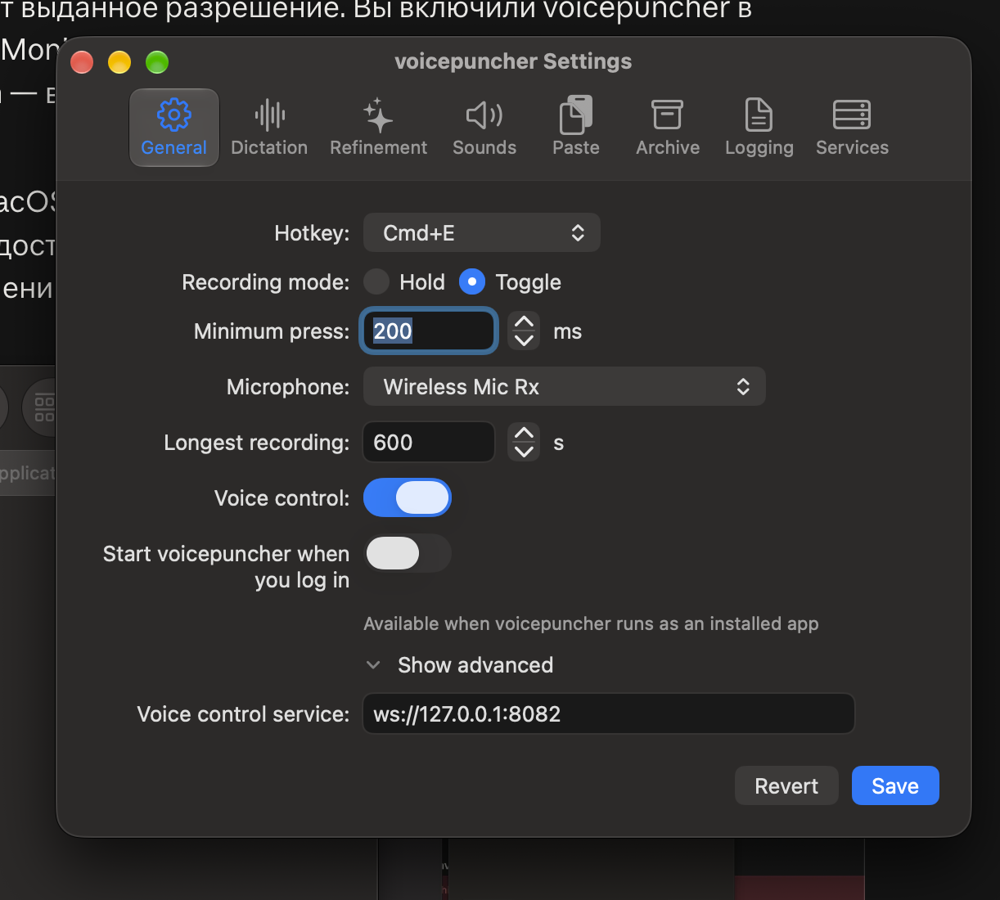
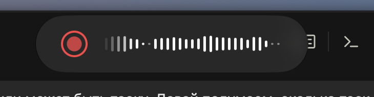

## Why

The first launch of the bundle `dist/voicepuncher.app` (v0.37.3, macOS 27.0.1) through the GUI, the way a user starts it, found eight bugs. Together they make the app unusable on a fresh install: it waits for a permission it cannot see, crashes on the first key press after a dictation, and its overlay barely shows the voice. Once the permissions were in place, voice start and paste worked well: the voice start took 778 ms, stop→paste 1107 ms.

1. **Granted Accessibility not seen.** The user switched voicepuncher on in **Device Control and Data Access** (what macOS 27 calls the Accessibility pane), but the Permissions window kept showing "Not granted" and the log kept `runtime: waiting for permissions: Accessibility`. It worked only after removing the entry with −, adding `dist/voicepuncher.app` again with + and relaunching. The likely cause: the entry that was switched on belonged to an earlier build's code identity. While the app waits, it does nothing at all — no hotkey, no voice command — and nothing outside the Permissions window says so.
   
   
2. **Input Monitoring cannot be granted from the window.** **Open System Settings** opens the Input Monitoring pane, but voicepuncher is not listed there, so there is nothing to switch on. `IOHIDCheckAccess` answered Denied, so the row showed only **Open System Settings** and no **Request…**, which the README promises. The workaround was adding the bundle by hand with +.
   
3. **Start at login cannot be switched.** In Settings → General the switch "Start voicepuncher when you log in" does not respond, with the note "Available when voicepuncher runs as an installed app", although the app runs from a bundle. `is_installed_bundle` accepts that path; the likely cause is that `status_of` (`app/src/adapters/secondary/loginitem/macos/mod.rs`) treats `SMAppServiceStatus::NotFound`, the normal status before the first registration, as Unavailable. The disabled switch also looks like an active one.
   
4. **Voice control looks on while it waits.** Settings shows Voice control switched on, and saying "start start" did nothing, because the pipeline was waiting for Accessibility. Neither Settings nor the menu bar says what the app waits for.
   
5. **Crash on the first key press after a dictation.** SIGTRAP (`EXC_BREAKPOINT`) on the thread `rdev-hotkey`: rdev 0.5.3 `raw_callback` → `Keyboard::string_from_code` → `TSMGetInputSourceProperty` → `dispatch_assert_queue_fail`. macOS 27 requires the main queue for input-source calls, and rdev translates every key event into a string on its own thread. Report: `~/Library/Logs/DiagnosticReports/voicepuncher-2026-10-22-200853.ips`; listener `app/src/adapters/primary/ptt/rdev/mod.rs`.
6. **False recording-limit warning.** After a 5.7 s live recording the log warned "Recording reached the 600-second limit and was cut off at that point". `stop()` in `app/src/adapters/secondary/recording/cpal/mod.rs` checks `buffer.is_full()`, and the live watcher's final chunk calls `cut_at(len)`, which lowers the buffer's limit to its length, so `is_full` holds.
7. **The overlay's border looks plain.** The user finds the border of the recording pill unattractive and wants a better one.
   
8. **The level waveform barely shows the voice.** Quiet sounds do not show at all, and loud speech gives bars of nearly the same height, low for how loudly the user speaks; there are no sharp steps. ChatGPT's dictation waveform shows a flat dotted line in silence and clear spikes on speech, which is the wanted look. The user asks to find out how the meter maps loudness (whether it is linear or logarithmic, and whether it suppresses noise). The model is `app/src/core/domain/level_history.rs`: loudness mapped linearly from -50 to -10 dBFS, smoothed with `RISE_RATE` 0.35 and `FALL_RATE` 0.12, one column per 200 ms, 2–28 pt high.
   

## What Changes

- The Permissions window shows a permission as Granted as soon as the user switches it on, without a relaunch. When the switch is on but the app is still not trusted (an entry of an earlier build), the window tells the user to remove the entry and add the app again. Each row names the pane as the running macOS names it ("Device Control and Data Access" on macOS 27) and opens that pane directly.
- Input Monitoring can be requested from the window also after a denial, so voicepuncher appears in the Input Monitoring list without adding it by hand.
- The start-at-login switch works for the app run from its bundle; a disabled switch looks disabled.
- While the app waits for a permission, Settings and the menu bar say so and name the permission, also for voice control.
- The hotkey listener no longer crashes on macOS 27: no key code is translated through the input-source API off the main thread.
- The recording-limit warning appears only when a recording really reached the limit.
- The recording pill gets a better-looking border.
- The level waveform shows silence as flat dots and speech as clearly varying spikes, with quiet sounds visible and loud ones not all the same height.

Current stage: PoC. Target stage: PoC.
Scope: the eight bugs above, found on the first GUI launch of the bundle: permissions gate, Input Monitoring request, start at login, the waiting state in Settings and menu bar, the hotkey listener crash, the recording-limit warning, the overlay's border and the level waveform.
Acceptance bar: on macOS 27, a fresh launch of the bundle gets all three permissions from the Permissions window without a relaunch or adding the app by hand; the start-at-login switch registers the login item; the app survives key presses after dictations; a short live recording logs no limit warning; the overlay's border and waveform pass the user's visual check against the ChatGPT screenshot; the manual run of README § Release checklist passes.
Out of scope: notarization and an Apple Developer ID signature; other overlay elements than its border and waveform.

## Capabilities

### Modified Capabilities

- `permissions-gate`: live recheck after a switch in System Settings, a hint for a stale entry, pane names and links as the running macOS has them, Request… for Input Monitoring after a denial.
- `launch-at-login`: the switch works for an app that has never registered its login item; a disabled switch looks disabled.
- `menu-bar-presence`: the menu bar says which permission the app waits for.
- `settings-window`: Settings says which permission voice control and dictation wait for.
- `push-to-talk`: the hotkey listener survives every key press on macOS 27.
- `live-transcript`: the recording-limit warning only on a recording that reached the limit.
- `visual-feedback`: the pill's border and the level waveform's mapping of loudness to bar height.

## Impact

- `app/src/adapters/secondary/permissions/macos/`, `app/src/core/application/permissions_gate.rs`, the Permissions window
- `app/src/adapters/secondary/loginitem/macos/mod.rs`, `app/src/adapters/primary/settings/macos/login.rs`
- `app/src/adapters/primary/ptt/rdev/mod.rs` (or a listener replacing rdev), `app/Cargo.toml`
- `app/src/adapters/secondary/recording/cpal/mod.rs`, `buffer.rs`
- `app/src/core/domain/level_history.rs`, the overlay adapter
- README § First launch and § Release checklist (macOS 27 pane names)

## Open points

- Bug 1: whether the stale entry really is an earlier build's identity, or `AXIsProcessTrustedWithOptions` stays stale in a running process on macOS 27; proposed: confirm with `tccutil reset Accessibility io.github.firstpilotpirx.voicepuncher` and two builds before choosing the fix.
- Bug 2: whether `IOHIDRequestAccess` adds a denied app to the list on macOS 27; proposed: try it, else open the pane with a hint to add the app with +.
- Bug 3: whether `SMAppService.mainApp` registers an app signed with the project's own certificate outside `/Applications`; proposed: allow the switch whenever the app runs from a bundle and show the registration error when macOS refuses.
- Bug 5: replace rdev by our own `CGEventTap` listener, or use an rdev version or fork that skips the key-string lookup; proposed: our own event tap, as the hotkeys need only key codes and modifier flags.
- Bug 7: what "a better border" means; proposed: a mockup of two or three variants for the user to pick before code.
- Bug 8: the target mapping; proposed: measure the levels of the user's voice, then a logarithmic (dBFS) mapping over a wider range with less smoothing, compared side by side with the ChatGPT screenshot.

## Release

SemVer: PATCH — bug fixes, no new capability.
Target version: 0.37.4.

## Absorbed by

`fix-permissions-and-login-item` (bugs 1–4), `fix-hotkey-crash-and-limit-warning` (bugs 5–6) and `improve-recording-pill-look` (bugs 7–8): the user asked to split the bugs into a few grouped changes, so this change closes without its own implementation.
