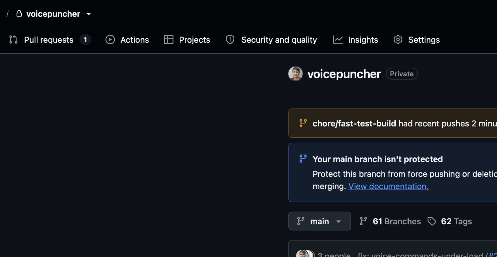

## Why

The GitHub repository has piled up stale branches: 61 remote branches on `origin` while only one pull request is open (`chore/refresh-human-docs`). The repository setting `delete_branch_on_merge` is off, so every squash-merged change leaves its head branch behind. Locally, 17 extra worktrees sit under `.claude/worktrees/` and `.worktrees/`, many detached and old.

## What Changes

- Delete the remote and local branches whose change already landed on `main` (PR merged), and prune the worktrees of those branches.
- List branches whose PR was closed without merge, or that have no PR, for the user before deleting them.
- Keep every branch with an open PR, a running session or a live worktree.
- Turn on `delete_branch_on_merge` for `firstpilotpirx/voicepuncher`.
- Make landing a change (`kit land`, and a manual `gh pr merge`) delete the head branch on `origin` and locally, and remove its worktree, so branches delete themselves when a change closes.

Current stage: PoC. Target stage: PoC.
Scope: git branches and worktrees of this repository, the GitHub repository setting, the landing flow.
Acceptance bar: after cleanup `origin` holds `main` plus branches of open PRs or running work only; a change landed afterwards leaves no branch on `origin`, no local branch and no worktree.
Out of scope: the app's behavior; tags (62 release tags stay).

## Capabilities

### Modified Capabilities

- none: tooling only, no spec changes.

## Impact

- GitHub repository settings (`delete_branch_on_merge`).
- Remote and local branches, `.claude/worktrees/`, `.worktrees/`.
- `kit land` (agent-kit) and any project recipe that merges PRs.

## Open points

- The self-delete part of `kit land` lives in agent-kit; proposed: fix it there and keep this change for the repository cleanup and setting.
- Branches without a merged PR (closed or none): proposed to list them for the user and delete only what the user confirms.

## Release

SemVer: no release — no behavior change in the app.
Target version: 0.37.2.
