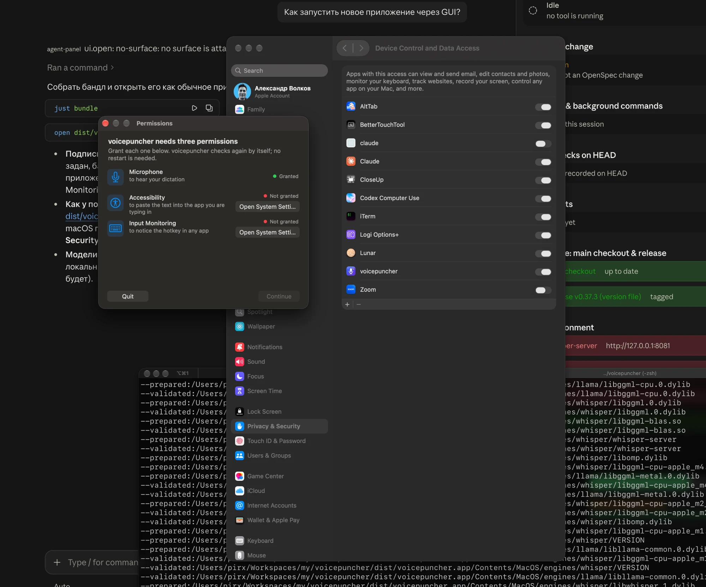
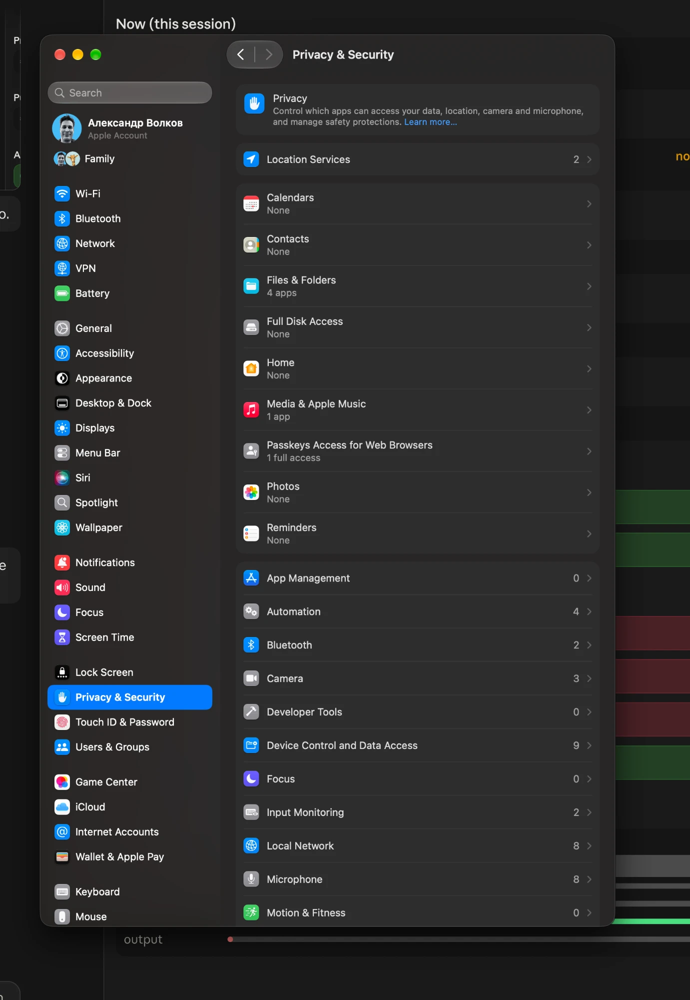
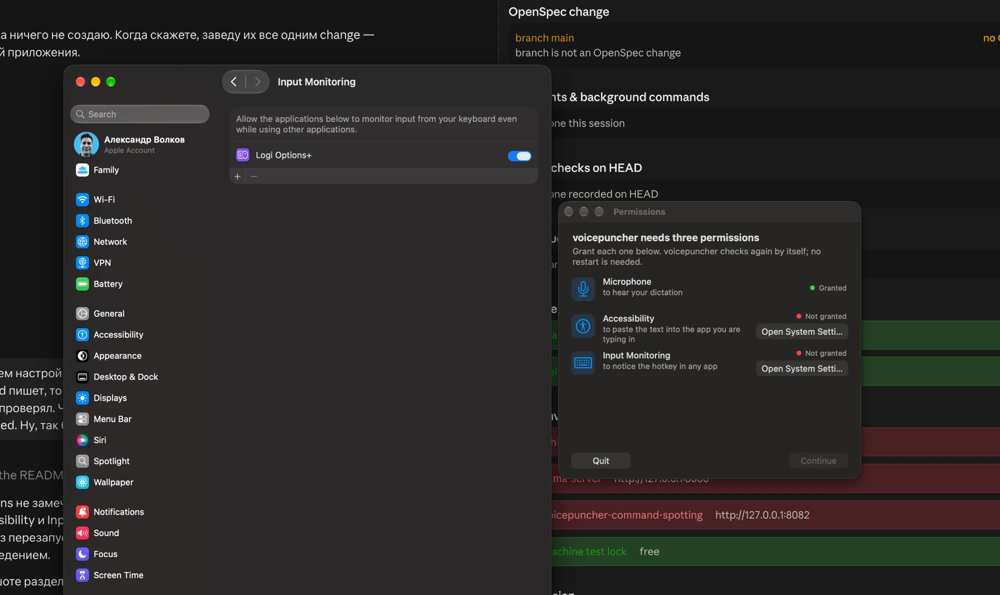
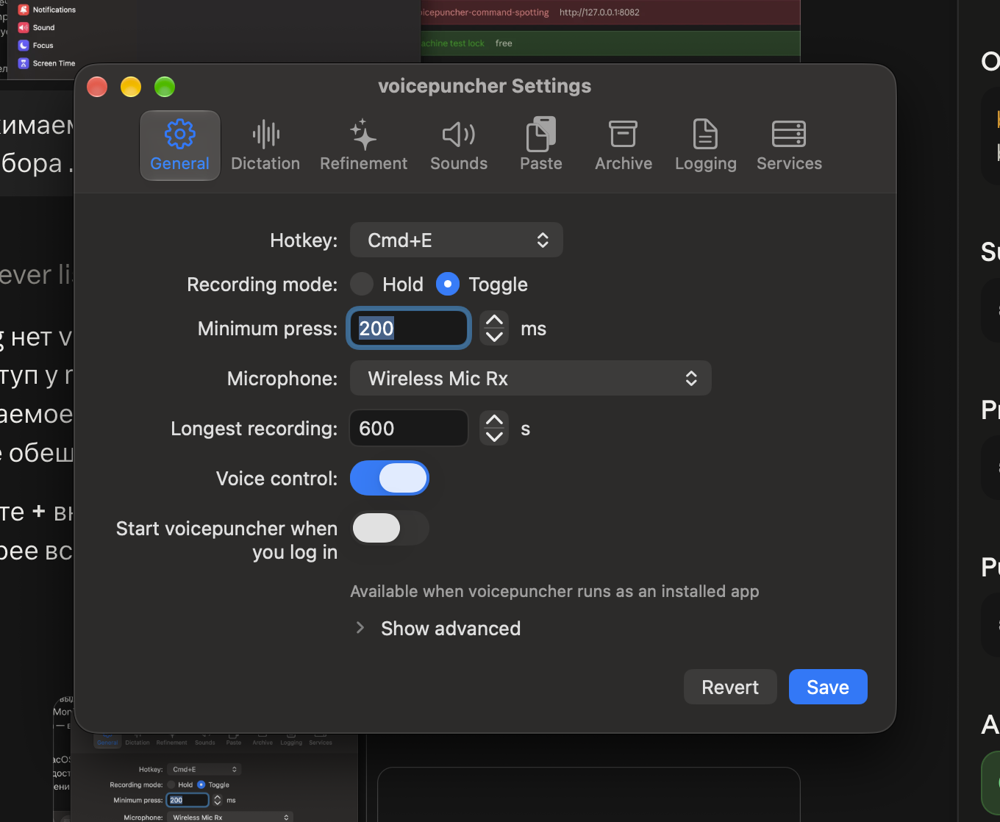

## Why

The first launch of the bundle `dist/voicepuncher.app` (v0.37.3, macOS 27.0.1) through the GUI, the way a user starts it, could not get past the permissions: the app waited for a permission it could not see, and while it waited it did nothing at all — no hotkey, no voice command — with nothing outside the Permissions window saying so. Split from `fix-first-gui-launch-bugs` (bugs 1–4).

1. **Granted Accessibility not seen.** The user switched voicepuncher on in **Device Control and Data Access** (what macOS 27 calls the Accessibility pane), but the Permissions window kept showing "Not granted" and the log kept `runtime: waiting for permissions: Accessibility`. It worked only after removing the entry with −, adding `dist/voicepuncher.app` again with + and relaunching. The likely cause: the entry that was switched on belonged to an earlier build's code identity (`AXIsProcessTrustedWithOptions(null)` in `app/src/adapters/secondary/permissions/macos/mod.rs`).
   
   
2. **Input Monitoring cannot be granted from the window.** **Open System Settings** opens the Input Monitoring pane, but voicepuncher is not listed there, so there is nothing to switch on. `IOHIDCheckAccess` answered Denied, so the row showed only **Open System Settings** and no **Request…**, which the README promises. The workaround was adding the bundle by hand with +.
   
3. **Start at login cannot be switched.** In Settings → General the switch "Start voicepuncher when you log in" does not respond, with the note "Available when voicepuncher runs as an installed app", although the app runs from a bundle. `is_installed_bundle` accepts that path; the likely cause is that `status_of` (`app/src/adapters/secondary/loginitem/macos/mod.rs`) treats `SMAppServiceStatus::NotFound`, the normal status before the first registration, as Unavailable. The disabled switch also looks like an active one.
   
4. **Voice control looks on while it waits.** Settings shows Voice control switched on, and saying "start start" did nothing, because the pipeline was waiting for Accessibility; the hotkey did nothing either. Neither Settings nor the menu bar says what the app waits for.
   

## What Changes

- The Permissions window shows a permission as Granted as soon as the user switches it on, without a relaunch. When the switch is on but the app is still not trusted (an entry of an earlier build), the window tells the user to remove the entry and add the app again. Each row names the pane as the running macOS names it ("Device Control and Data Access" on macOS 27) and opens that pane directly.
- Input Monitoring can be requested from the window also after a denial, so voicepuncher appears in the Input Monitoring list without adding it by hand.
- The start-at-login switch works for the app run from its bundle; a disabled switch looks disabled.
- While the app waits for a permission, Settings and the menu bar say so and name the permission, also for voice control.

Current stage: PoC. Target stage: PoC.
Scope: the permissions gate, the Input Monitoring request, start at login, the waiting state in Settings and the menu bar.
Acceptance bar: on macOS 27, a fresh launch of the bundle gets all three permissions from the Permissions window without a relaunch, adding the app with + only where Open System Settings shows it in Finder because the system did not list it; the start-at-login switch registers the login item; while a permission is missing, Settings and the menu bar name it; the manual run of README § Release checklist (permissions, bundle) passes.
Out of scope: notarization and an Apple Developer ID signature; the hotkey listener crash and the overlay (changes `fix-hotkey-crash-and-limit-warning`, `improve-recording-pill-look`).

## Capabilities

### Modified Capabilities

- `permissions-gate`: live recheck after a switch in System Settings, a hint for a stale entry, pane names and links as the running macOS has them, Request… for Input Monitoring after a denial.
- `launch-at-login`: the switch works for an app that has never registered its login item; a disabled switch looks disabled.
- `menu-bar-presence`: the menu bar says which permission the app waits for.
- `settings-window`: Settings says which permission voice control and dictation wait for.

## Impact

- `app/src/adapters/secondary/permissions/macos/`, `app/src/core/application/permissions_gate.rs`, the Permissions window
- `app/src/adapters/secondary/loginitem/macos/mod.rs`, `app/src/adapters/primary/settings/macos/login.rs`
- the menu bar status and Settings → General
- README § First launch and § Release checklist (macOS 27 pane names)

## Open points

- Bug 1: whether the stale entry really is an earlier build's identity, or `AXIsProcessTrustedWithOptions` stays stale in a running process on macOS 27; proposed: confirm with `tccutil reset Accessibility io.github.firstpilotpirx.voicepuncher` and two builds before choosing the fix.
- Bug 2: whether `IOHIDRequestAccess` adds a denied app to the list on macOS 27; proposed: try it, else open the pane with a hint to add the app with +.
- Bug 3: whether `SMAppService.mainApp` registers an app signed with the project's own certificate outside `/Applications`; proposed: allow the switch whenever the app runs from a bundle and show the registration error when macOS refuses.

## Release

SemVer: PATCH — bug fixes, no new capability.
Target version: 0.38.3 (the next PATCH above `main` when it merges).
