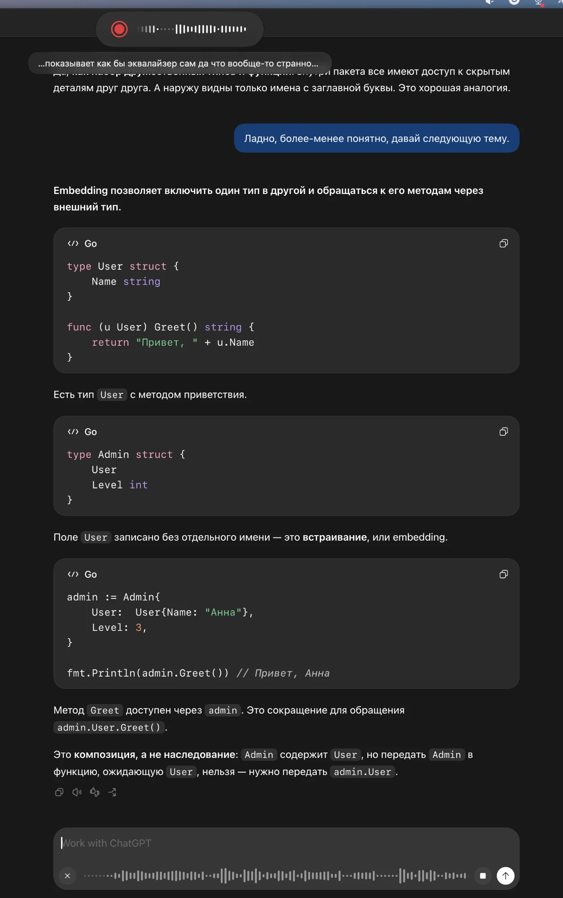
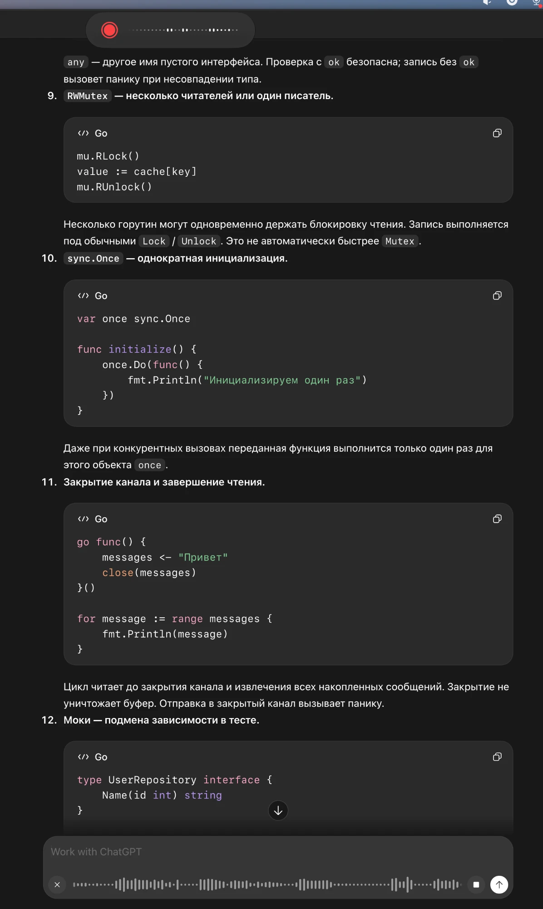
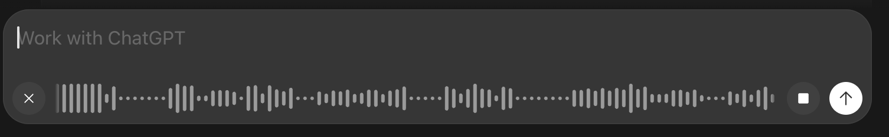
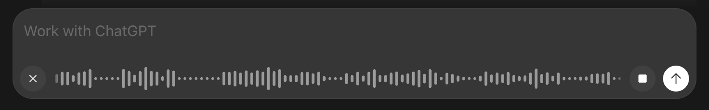
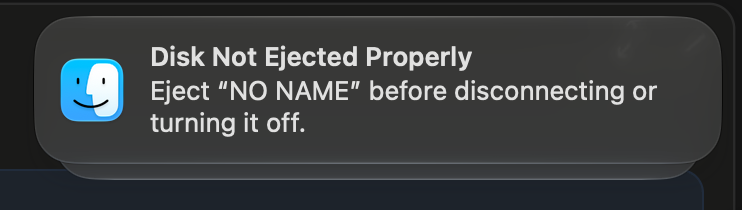

## Why

On the first GUI launch of the bundle (v0.37.3, macOS 27.0.1) the user found the recording pill hard to read, plain and too short. Split from `fix-first-gui-launch-bugs` (bugs 7–8); absorbs `widen-recording-pill`, which changes the same widget.

1. **The level waveform barely shows the voice.** Quiet sounds do not show at all, and loud speech gives bars of nearly the same height, low for how loudly the user speaks; there are no sharp steps. ChatGPT's dictation waveform shows a flat dotted line in silence and clear spikes on speech, which is the wanted look. The model is `app/src/core/domain/level_history.rs`: loudness mapped linearly from -50 to -10 dBFS, smoothed with `RISE_RATE` 0.35 and `FALL_RATE` 0.12, one column per 200 ms (its window peak), 2–28 pt high. Measured on the user's recordings (`~/.voicepuncher/voice-samples/`, 10 ms frames): the room's silence lies at -80…-65 dBFS, the user's speech mostly at -55…-25 dBFS (99th percentile -25), so most speech maps to the bottom third of the bar and nothing reaches the top.
   
2. **The pill's border looks plain.** The user finds the border of the recording pill unattractive and wants a better one.
   
3. **The pill is too short and its ends look foreign on macOS** (from `widen-recording-pill`). The user wants it as long as ChatGPT's voice input bar and shaped like macOS panels and notifications: a superellipse with continuous corners, not a capsule with half-circle ends.
   
   
   
   
   

## What Changes

- The level waveform shows silence as flat dots and speech as clearly varying spikes: loudness mapped from the room's noise floor (-62 dBFS) to the user's loud speech (-28 dBFS), faster rise and fall, one column every 100 ms.
- The pill is about twice as long, as long as ChatGPT's voice bar: the waveform holds the last 9 s in narrower, denser columns.
- Its outline is a superellipse with continuous corners, like macOS notifications, instead of a capsule.
- Its border is a thin, faint hairline (1 pt, white at 15 %) over the soft shadow it has, like macOS system HUDs.
- Its height, colours and position stay as they are.

Current stage: PoC. Target stage: PoC.
Scope: the level waveform's mapping of loudness to bar height, its smoothing, column period and density; the pill's width, outline and border.
Acceptance bar: unit tests pin the new mapping (silence → dots, the user's speech levels → distinct heights) and the new period; the pill keeps one size in every state; the user checks the look in the running app after the merge and files a fix if needed (decision at preparation: no mockup, no stop).
Out of scope: other overlay elements than the border, the outline, the width and the waveform; the permissions gate and the hotkey crash (changes `fix-permissions-and-login-item`, `fix-hotkey-crash-and-limit-warning`).

## Capabilities

### Modified Capabilities

- `visual-feedback`: the pill's outline, border and length, and the level waveform's period, length and mapping of loudness to bar height.

## Impact

- `app/src/core/domain/level_history.rs`
- the overlay adapter that draws the pill (`app/src/adapters/secondary/visualfeedback/macos/`: `window_set.rs`, `glass.rs`, `waveform.rs`)

## Release

SemVer: PATCH — a visual fix, no new capability.
Target version: 0.38.4 (the next PATCH above `main`).
