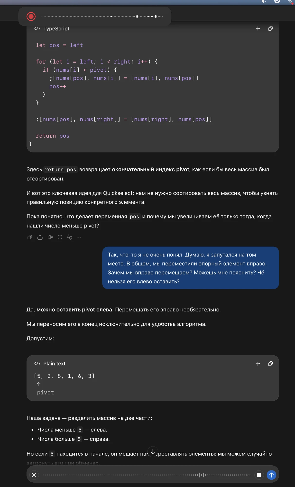

## Why

The user compared the recording pill with ChatGPT's dictation bar on one screen: ChatGPT's bar is about 1.65 times longer from left to right, and the user wants the pill as long as it. Today the pill is about 447 pt wide: its width comes from the waveform, which keeps the last 9 s of the recording (90 columns, 4 pt apart).

## What Changes

- The waveform keeps the last 16 s of the recording (160 columns instead of 90; 148 instead of 78 beside the commands-unavailable sign), so the pill grows to about 727 pt, as long as ChatGPT's bar in the screenshot; the waveform still fills the pill from end to end.
- Every other state keeps the pill's one width (the existing rule), so the start, Recognizing, Pasted, command and failure pills grow with it; the commands-unavailable sign alone in standby stays small.

Current stage: PoC. Target stage: PoC.
Scope: the waveform's column count and the pill width that follows from it.
Acceptance bar: the recording pill is about 727 pt wide (1.63 times today's 447 pt) with the waveform spanning it; every state keeps that one width; the unit tests of the pill width and the level history pass.
Out of scope: the pill's height, the column pitch and heights, the colours, the position on screen.

## Capabilities

### Modified Capabilities

- `visual-feedback`: the recording waveform keeps the last 16 s instead of 9 s, so the pill is about as long as ChatGPT's dictation bar.

## Impact

- `app/src/core/domain/level_history.rs` (`FULL_CAPACITY`, `CAPACITY_BESIDE_SIGN`)
- `app/src/adapters/secondary/visualfeedback/macos/pill_content.rs` (pill width test)

## Open points

- The user picked "as ChatGPT, ~520 pt"; measured against today's pill (447 pt, not 315 pt as first estimated) the ChatGPT bar is about 727 pt. Proposed choice: follow the screenshot's ratio, about 727 pt.

## Release

SemVer: PATCH — a visual adjustment of an existing capability.
Target version: 0.38.5.
