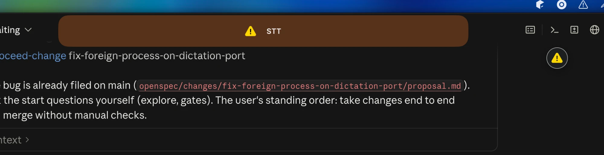

## Why

Dictation stopped working for the user: they dictate, say "stop", the pill shows an exclamation mark and nothing is pasted. The log of 2026-10-25 shows every chunk after 17:31Z lost: `speech recognition service dropped the connection … http://127.0.0.1:8081/v1/audio/transcriptions: Broken pipe / Connection reset by peer / Invalid argument`, then `chunk 1 lost … failed on copies 8081` and the notice "Dictation lost: speech recognition failed — start the local services".

The cause: a foreign program (a `go run` build, `/var/folders/.../go-build…/exe/app`, started 2026-10-25 18:31 local) listens on `*:8081`, the dictation speech recognition port. The app's own `whisper-server` copies are alive on 18082–18084 (started by the app on 2026-10-22), yet the app sends its requests to 8081 alone ("failed on copies 8081"), so the audio goes to the foreign program. The notice then tells the user to start services that are already running, and the dictation is lost.

## What Changes

- A client of a speech recognition service (dictation and commands) counts a port as a copy only when it answers as a whisper-server, never when it merely accepts a connection; another program on the service's port is passed over and the copies are used.
- The client logs once per port the program that holds it: port, name, process id.
- When another program holds the port, the app says so in the notice and the log, naming the port and the process, instead of "start the local services".
- The dictation is not lost while a healthy copy is reachable.

Current stage: PoC. Target stage: PoC.
Scope: how the app finds and checks the speech recognition copies it sends dictation to, and the failure notice.
Acceptance bar: a test with a foreign HTTP server on the dictation port and live copies on the copy ports transcribes the dictation through the copies; a test with only a foreign program shows the notice naming the port; the user's dictation works while the Go program holds 8081.
Out of scope: freeing the port, the command speech recognition and command spotting ports beyond the same check.

## Capabilities

### Modified Capabilities

- `local-services`: the app checks that the speech recognition copies it uses are its services, and reports a foreign process on their port.

## Impact

- the copy pool (`copy-pool/`, used by the app and the command spotting service), the app's speech recognition adapter, the failure notice text, the copy-port wording in `AGENTS.md`

## Open points

- Why the app reached only 8081: the service manager checks that a port answers as a whisper-server, but the client's copy pool (`copy-pool/`) checks only that the port accepts a TCP connection, and takes the service's own port alone when it does. The copies on 18082–18084 are where they belong (port + 10001…10004); only the wording "ten thousand above" in `AGENTS.md` is loose and is corrected here.
- The command speech recognition port (8085) shares the copy pool and gets the same check. The command spotting client (8082) already falls back to its copies when the WebSocket handshake fails, so it stays as it is.

## Release

SemVer: PATCH — a bug fix.
Target version: 0.38.7.
