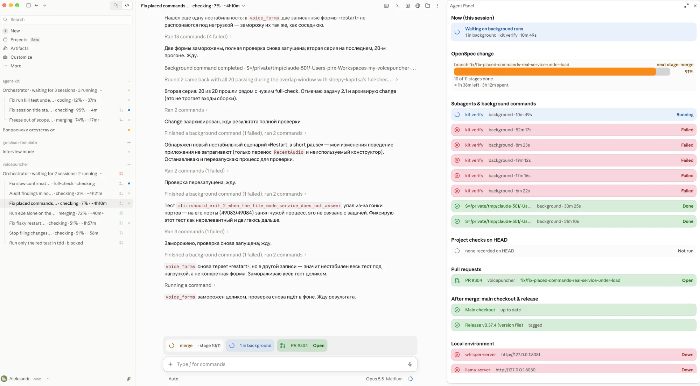

## Why

Checks fail far more often than the code changes justify. In the stage journal (`~/.cache/voicepuncher/stage-times.jsonl`) the voice control smoke stage `e2e-smoke-voice` passed 8 of 8 runs on 2026-10-20 and 2026-10-21, then failed 8 of 30 on 2026-10-22 and 11 of 61 on 2026-10-23; 48 of 66 `full-check` runs failed since 2026-10-22. The failures began at 2026-10-22 01:12, a few hours after `split-machine-lock` landed (#259, 2026-10-21 18:24) and when the orchestrator started many changes in parallel. That change split the machine lock into a light class (`e2e-smoke-voice`, `e2e-regression`, `e2e-resilience`) and a heavy class, and lets one run's light phase run beside another run's heavy phase, so the timing-sensitive voice tests share the GPU with another check's models.

The failing tests are almost all timing-sensitive voice tests that have nothing to do with the branch under check:

- `voice_forms::should_carry_out_every_recorded_way_of_saying_the_commands` (6 times);
- `placed_commands::should_hear_a_chain_of_commands`, `placed_commands::should_hear_a_stop_right_after_the_last_dictated_word`;
- the scenarios "Restart, a short pause, then the new dictation", "A chain of commands takes effect in order", "Requests wait their turn when every copy is busy".

Each such failure makes a change session freeze the test and rerun a 20–50 min `full-check`, so one session collected six red `kit verify` runs in a row (screenshot below), and frozen tests pile up.

The user wants every test and check stage that uses the GPU or a model engine to run strictly one at a time on the machine, in exclusive mode.

## What Changes

- Every stage that uses the GPU or a model engine (`whisper-server`, `whisper-server-commands`, `llama-server`, `voicepuncher-command-spotting` with sherpa-onnx) — the model stages of `check` and `full-check`, the E2E, benchmark and `rerun-failed` recipes — takes one exclusive GPU lock: no model stage of one run ever overlaps a model stage of another run on the machine.
- The light/heavy split of `split-machine-lock` goes: no class runs beside another; the current lock is extended (or replaced by one exclusive lock) rather than a second parallel mechanism added.
- Builds, `fmt`, `lint`, `just test`, `metrics` and `just release` stay unlocked and keep running in every session at once.
- The stage journal and `just stage-times` show the GPU lock's wait and hold, so an overlap can be ruled out from the journal.
- Tests frozen as load flakes in the sessions of 2026-10-22..23 (among them `voice_forms` frozen whole) are unfrozen and pass.

Current stage: PoC. Target stage: PoC.
Scope: the machine lock and its classes in the `justfile`, the lock wait/hold in the stage journal, the frozen load-flake tests, and the AGENTS.md text describing lock classes.
Acceptance bar: the journal shows no two model stages of different runs overlapping; `e2e-smoke-voice` passes in every `full-check` over at least the first 20 runs after landing (`just stage-times`); every unfrozen test passes; builds and unit tests still start without waiting for the lock.
Out of scope: the app's own runtime behavior; speeding the model stages up; the number of changes the orchestrator runs at once.

## Capabilities

### Modified Capabilities

- `change-workflow`: model stages of checks run under one exclusive GPU lock; the light/heavy lock classes are removed.

## Impact

- `justfile` (`light_stages`, `exclusive_stages`, lock recipes, `_stages`), the stage journal and `just stage-times`.
- `AGENTS.md` § How to verify a change (Lock classes) and § Workflow (parallel changes).
- Tests frozen as load flakes in `app/`, `command-spotting/`, `e2e-test/`.

## Open points

- Whether the `e2e-cues` quiet lock (builds wait while cue timing runs) stays as it is — proposed: keep it.
- Whether `full-check` holds the GPU lock once for all its model stages or takes it per stage — proposed: once per run, so a run's stages are not interleaved with another run's.
- Total check time rises because parallel model phases are gone — proposed: accept it, a red check costs a full rerun.
- How to find every test frozen as a load flake — proposed: search the branches merged since 2026-10-22 for freeze markers and list them in `tasks.md`.

## Release

SemVer: no release — only the test tooling changes, the app's behavior does not.
Target version: 0.37.4.
