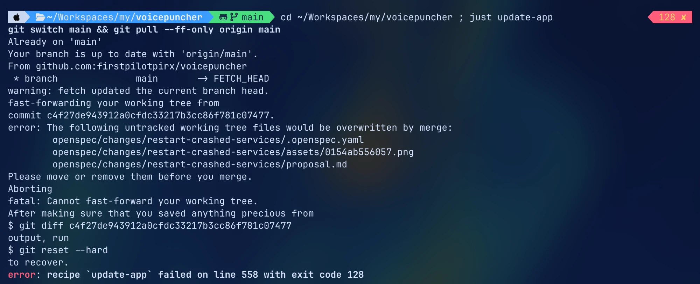

## Why

On 2026-10-27 the user ran `just update-app` in the main checkout. It failed at its first step, `git switch main && git pull --ff-only origin main`, with exit code 128 and left the app neither rebuilt nor relaunched:

Git printed "warning: fetch updated the current branch head", then refused the fast-forward because "the following untracked working tree files would be overwritten by merge": the three files of the change `restart-crashed-services`, which an agent session was filing at that same moment. `kit propose` lands a filed change on `main` and then updates the main checkout. Its update and the pull of `update-app` ran at the same time and collided. A few seconds later the checkout was clean and at `origin/main` with nothing lost, but the recipe had already stopped. Git's own advice in the output, `git reset --hard`, is wrong and dangerous here.

The user starts `update-app` whenever they like, while agent sessions file and land changes in the background. These two things must never break each other.

## What Changes

- `just update-app` no longer fails when the main checkout is updated at the same moment by another program, such as `kit propose`, `kit propose-land` or `kit land`. It waits for that update to finish, or it sees that the checkout already reached `origin/main`, and then goes on with the rebuild and relaunch.
- When `update-app` really cannot update the checkout (local changes, another branch), it stops with one clear line: what blocks it and what to do. It never shows git's suggestion to run `git reset --hard`.
- The update of the main checkout that agent sessions make never leaves untracked files that collide with a concurrent `git pull` of the user.

Current stage: PoC. Target stage: PoC.
Scope: the `update-app` recipe and how it and the agent-side update of the main checkout share that checkout.
Acceptance bar: `just update-app` started while a change is being filed and landed on `main` finishes, rebuilds and relaunches the app with the newest `main`.
Out of scope: the rebuild and the bundle themselves, and `cargo watch`.

## Capabilities

### Modified Capabilities

- `change-workflow`: the main checkout is updated safely when the user's `update-app` and an agent's landing run at the same time.

## Impact

- `justfile` (`update-app`) and, where it fits, `dev-tools`.
- The update of the main checkout in agent-kit's `kit propose`, `kit propose-land` and `kit land` (a lock or an atomic update). That part may belong in agent-kit rather than in this repository.

## Open points

- Where the fix lives: proposed — a shared lock on the main checkout's update, taken by both `update-app` and kit, with the kit part filed in agent-kit if needed.
- How `update-app` should wait: proposed — up to about 30 s for the lock, then the clear stop line.
- Which capability holds this: proposed `change-workflow`; to confirm at the specs stage.

## Release

SemVer: PATCH — bug fix in a developer recipe.
Target version: 0.41.3.
