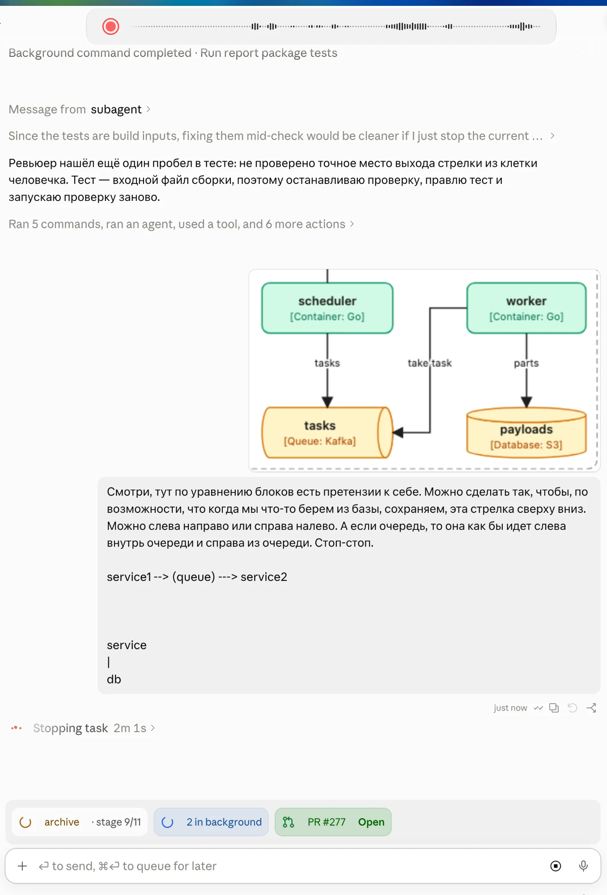
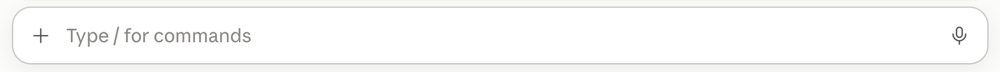
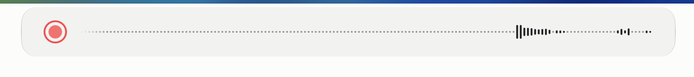

## Why

The recording pill (record sign + waveform) is narrower than the Claude desktop chat input box it sits above: about 727 pt against about 922 pt on the user's screen. The user wants the pill to be the same length as that input box, so the two line up.

## What Changes

- The recording pill becomes about 922 pt wide, the width of the chat input box in the screenshots, by lengthening the waveform: about 209 columns instead of 160, and about 197 instead of 148 beside the commands-unavailable sign.
- Every pill state that shares the one pill width (recording, transcribing, command, …) gets the new width; the lone commands-unavailable sign keeps its own small width.
- The width stays fixed: it does not follow the size of the Claude window or any other window.

Current stage: PoC. Target stage: PoC.
Scope: the pill width and the waveform column counts.
Acceptance bar: the pill measures about 922 pt in every state that uses the one pill width, the width tests pass with the new numbers, and the user confirms in a manual run that it matches the input box.
Out of scope: pill height, colors, waveform pitch and column shape, the transcript window, following another window's width.

## Capabilities

### Modified Capabilities

- `visual-feedback`: the recording pill width and the number of waveform columns.

## Impact

- `app/src/core/domain/level_history.rs` (`FULL_CAPACITY`, `CAPACITY_BESIDE_SIGN`)
- `app/src/adapters/secondary/visualfeedback/macos/pill_content/mod.rs` (`one_pill_width`) and its tests
- `app/src/adapters/secondary/visualfeedback/macos/waveform.rs` width tests

## Open points

- Exact column counts: proposed 209 and 197 at the current 4 pt pitch, so the pill lands at about 922 pt; the design confirms the arithmetic.
- The capability name `visual-feedback` is assumed; the specs stage uses the capability that holds the pill requirements.
- Whether the pill must still fit on a small screen (e.g. a 1280 pt wide display): proposed yes, it fits as is.

## Release

SemVer: PATCH — a visual adjustment of an existing capability.
Target version: 0.41.4.
