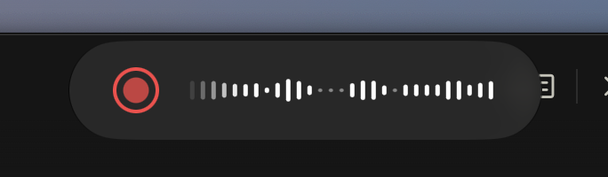

## Why

The recording pill (the floating widget shown while recording: red record button and the level bars) is too short: the user wants it about twice as long, so the level bars span more width and read better.

## What Changes

- The recording pill is about twice as long as now (width ×2); its height and look stay as they are.
- The level bars fill the longer pill (more bars or wider spacing, decided in design).

Current stage: PoC. Target stage: PoC.
Scope: the width of the recording pill and how its level bars fill it.
Acceptance bar: the pill on screen is about twice its current width, bars fill it, and the user confirms in the manual run.
Out of scope: the pill's colors, height, position and the other changes of `improve-recording-pill-look`.

## Capabilities

### Modified Capabilities

- `visual-feedback`: the recording pill's width doubles.

## Impact

- `app/src/adapters/secondary/visualfeedback/**` (overlay: manual run needed).

## Open points

- Exact width: twice the current width, proposed as is.
- More bars or wider spacing between them: proposed more bars at the same spacing.
- Overlap with `improve-recording-pill-look` (same widget): proposed to run after it, or merge into it if it has not started.

## Release

SemVer: PATCH — a visual tweak of an existing widget.
Target version: 0.37.5.
